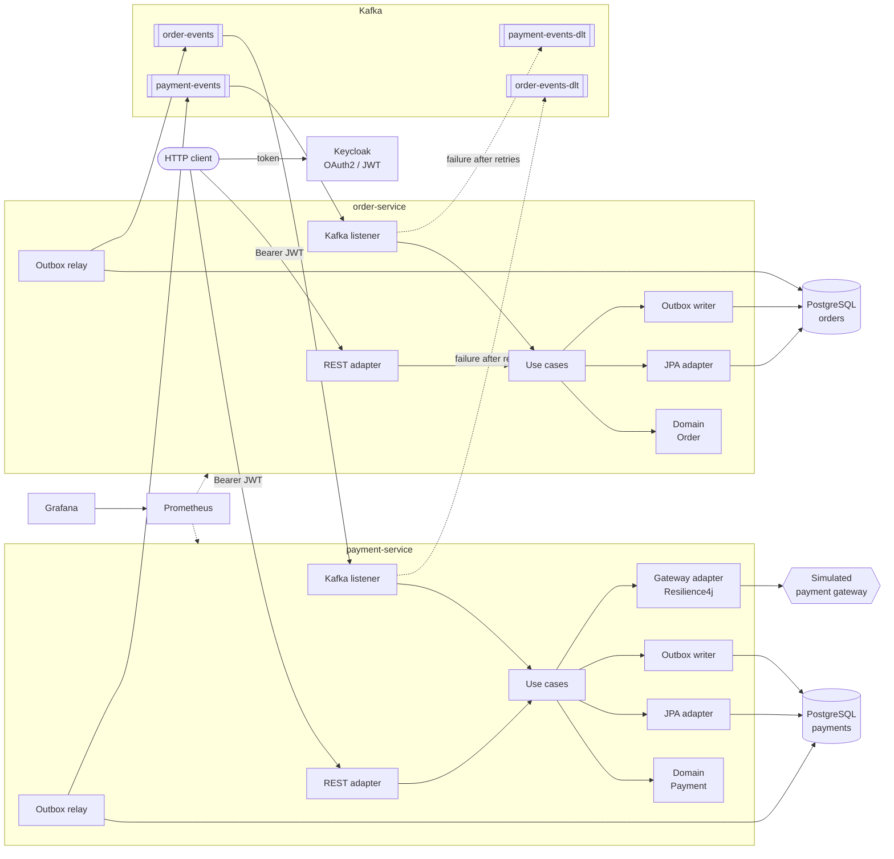
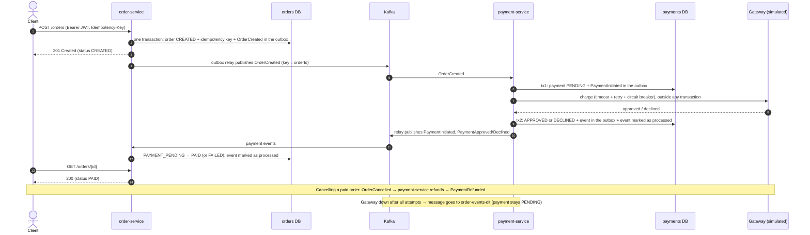

# Orders and Payments

[](https://github.com/emanoeladolpho/pedidos-pagamentos/actions/workflows/ci.yml)


[🇧🇷 Português](README.md) | 🇺🇸 English

An **order and payment** platform made of two independent microservices that talk through Kafka events.
It uses a small, well-known domain to show the decisions that show up in real distributed systems: consistency
without distributed transactions, at-least-once delivery, idempotency, partial failures, contracts between services
and observability.

- **order-service**: places orders (with an `Idempotency-Key`), computes totals, drives the lifecycle
  (`CREATED → PAYMENT_PENDING → PAID`, `FAILED`, `CANCELLED`), cancels and queries.
- **payment-service**: charges each order on a simulated gateway (configurable failures and declines),
  handles refunds and queries.

> Code identifiers, logs and the remaining docs (ADRs, Q&A, limitations) are written in Portuguese.

## Highlights

| Topic | Approach |
|---|---|
| Architecture | Hexagonal + Clean Architecture + tactical DDD; domain and use cases **free of Spring/JPA**, enforced by **ArchUnit** |
| Cross-service consistency | Choreographed saga; **Transactional Outbox** (`FOR UPDATE SKIP LOCKED`) instead of dual writes |
| Duplicate delivery | **Idempotent consumers** (`processed_events` table) and gateway calls with an idempotency key |
| Repeated requests | **`Idempotency-Key`** header on order creation (replay returns the same order; different body → 422) |
| Provider failures | **Resilience4j** (timeout, retry with backoff, circuit breaker) + **Dead Letter Topic** |
| Event ordering | Partition key = order id |
| Contracts | **Pact** message contracts in both directions, versioned and checked in CI |
| Security | **Keycloak** (OAuth2/OIDC), JWT validated locally, `USER` and `ADMIN` roles |
| Errors | **Problem Details** (RFC 9457) with `code`, `timestamp` and `correlationId` on every error response |
| Observability | JSON logs with a **correlation id propagated HTTP → outbox → Kafka → other service**; Micrometer + Prometheus + Grafana |
| Quality | 185 tests: domain, use cases, ArchUnit, Testcontainers, contract and end-to-end; **JaCoCo ≥ 80%** enforced by the build |

## Architecture



Both services share the same layering, with dependencies always pointing inwards:

```
order-service/src/main/java/io/github/emanoeladolpho/order
├── domain/            # Order, OrderItem, value objects, events — plain Java
├── application/
│   ├── port/in/       # one use case per interface (PlaceOrderUseCase, CancelOrderUseCase...)
│   ├── port/out/      # what the application needs from the outside (OrderRepository, UnitOfWork, ...)
│   └── usecase/       # implementations — no framework annotations
└── infrastructure/
    ├── adapter/in/    # web (REST) and messaging (Kafka listener)
    ├── adapter/out/   # persistence (JPA + MapStruct) and messaging (outbox)
    └── config/        # composition root: wires ports to adapters
```

The **`service-chassis`** module holds the cross-cutting infrastructure that belongs to no domain: outbox, inbox,
Kafka error handling (retry + DLT), correlation id, Problem Details and JWT validation. It is a Spring Boot
auto-configuration: a service only needs to declare the dependency.

## Order flow



## Running it

Requirements: Docker with Docker Compose. For the tests, Java 21 (the Maven Wrapper is included).

```bash
cp .env.example .env          # change the passwords
docker compose up -d --build  # 2 services, 2 PostgreSQL, Kafka, Keycloak, Prometheus and Grafana
./scripts/fluxo-completo.sh   # runs the whole flow end to end (needs curl and python3)
```

| Service | Address |
|---|---|
| order-service (Swagger) | http://localhost:8081/swagger-ui.html |
| payment-service (Swagger) | http://localhost:8082/swagger-ui.html |
| Keycloak (realm `pedidos`) | http://localhost:8080 (port set by `KEYCLOAK_PORT`) |
| Grafana (*Pedidos e Pagamentos* dashboard) | http://localhost:3000 |
| Prometheus | http://localhost:9090 |

Demo users: `cliente` (role `USER`) and `admin` (roles `USER` and `ADMIN`), with the passwords set in
`KC_DEMO_USER_PASSWORD` and `KC_DEMO_ADMIN_PASSWORD`.

The simulated gateway accepts "magic" amounts for deterministic tests: a total ending in **.13** is declined and
**.66** simulates a provider outage. `GATEWAY_FAILURE_RATE` and `GATEWAY_DECLINE_RATE` add random failures on top.

### Tests

```bash
./mvnw test     # unit, use case, ArchUnit and contract tests (no Docker)
./mvnw verify   # + Testcontainers integration, end-to-end and the 80% coverage gate (needs Docker)
```

| Kind | Where | What it guarantees |
|---|---|---|
| Domain | `*/domain/*Test` | rules and state transitions, no framework |
| Use cases | `*/application/*Test` | orchestration with mocked ports (idempotency, replay, refunds...) |
| Architecture | `HexagonalArchitectureTest` | inward dependencies; domain/application free of Spring/JPA |
| Web | `*ControllerTest` | validation, HTTP status codes, Problem Details, access rules |
| Integration | `*IT` | JPA + Liquibase on real PostgreSQL; outbox → Kafka; consumers; DLT |
| Contract | `*PactTest` | messages produced by one service satisfy what the other consumes |
| End-to-end | `OrderPaymentFlowE2EIT` | both real services, 2 databases, Kafka and signed JWTs: paid, declined, cancelled/refunded |

## Request examples

```bash
TOKEN=$(curl -s localhost:8080/realms/pedidos/protocol/openid-connect/token \
  -d grant_type=password -d client_id=pedidos-api -d username=cliente -d password="$KC_DEMO_USER_PASSWORD" \
  | python3 -c 'import sys,json; print(json.load(sys.stdin)["access_token"])')

# Place an order
curl -s localhost:8081/orders -H "Authorization: Bearer $TOKEN" -H 'Content-Type: application/json' \
  -H "Idempotency-Key: $(uuidgen)" -H 'X-Correlation-Id: demo-123' \
  -d '{"currency":"BRL","items":[{"sku":"TECLADO-MEC-01","productName":"Mechanical keyboard","unitPrice":349.90,"quantity":1}]}'

# Order and payment
curl -s localhost:8081/orders/{id} -H "Authorization: Bearer $TOKEN"
curl -s "localhost:8082/payments?orderId={id}" -H "Authorization: Bearer $TOKEN"

# Cancel (refunds if already paid)
curl -s -X POST localhost:8081/orders/{id}/cancel -H "Authorization: Bearer $TOKEN" \
  -H 'Content-Type: application/json' -d '{"reason":"Changed my mind"}'
```

### Endpoints

| Method | Path | Role | Description |
|---|---|---|---|
| POST | `/orders` | USER | Place an order (`Idempotency-Key` header required) |
| GET | `/orders/{id}` | USER | Get an order (customers see only their own; ADMIN sees all) |
| GET | `/orders?page=&size=` | USER | Paginated list |
| POST | `/orders/{id}/cancel` | USER | Cancel; triggers a refund if paid |
| GET | `/payments/{id}` | USER | Get a payment |
| GET | `/payments?orderId=` | USER | Payment of an order |
| POST | `/payments/{id}/refund` | ADMIN | Manual refund (the order is cancelled afterwards) |

## Documentation (Portuguese)

- [docs/PLANO.md](docs/PLANO.md): phased implementation plan
- [docs/adr/](docs/adr/): architecture decision records
- [docs/DECISOES.md](docs/DECISOES.md): interview-style Q&A about the design
- [docs/LIMITACOES.md](docs/LIMITACOES.md): what was left out and how it would be done

## License

[MIT](LICENSE)
