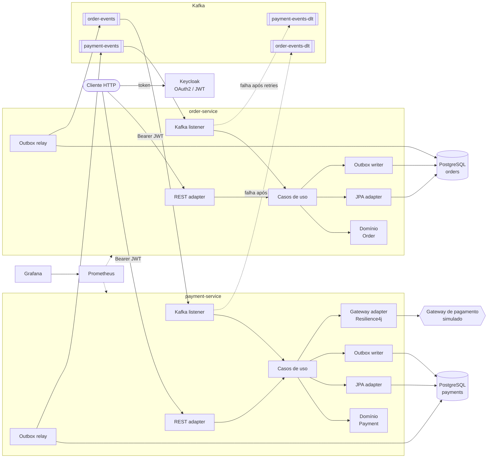
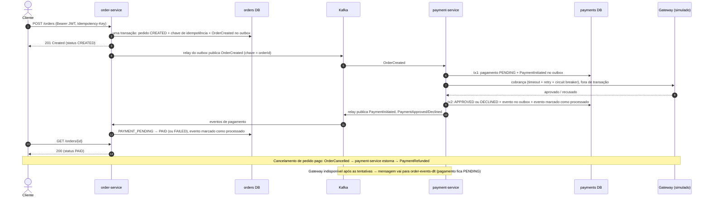

# Pedidos e Pagamentos

[](https://github.com/emanoeladolpho/pedidos-pagamentos/actions/workflows/ci.yml)


🇧🇷 Português | [🇺🇸 English](README.en.md)

Plataforma de **pedidos e pagamentos** com dois microsserviços independentes que conversam por eventos no Kafka.
O objetivo é mostrar, em um domínio pequeno e conhecido, as decisões que aparecem em sistemas distribuídos reais:
consistência sem transação distribuída, entrega *at-least-once*, idempotência, falhas parciais, contratos entre
serviços e observabilidade.

- **order-service**: cria pedidos (com `Idempotency-Key`), calcula o total, controla o ciclo de vida
  (`CREATED → PAYMENT_PENDING → PAID`, `FAILED`, `CANCELLED`), cancela e consulta.
- **payment-service**: processa o pagamento de cada pedido num gateway simulado (falhas e recusas configuráveis),
  faz estornos e consultas.

## Destaques

| Tema | Como foi resolvido |
|---|---|
| Arquitetura | Hexagonal + Clean Architecture + DDD tático; domínio e casos de uso **sem Spring/JPA**, verificado por **ArchUnit** |
| Consistência entre serviços | Saga coreografada; **Transactional Outbox** (`FOR UPDATE SKIP LOCKED`) em vez de *dual write* |
| Entrega duplicada | Consumidores **idempotentes** (tabela `processed_events`) e gateway chamado com chave de idempotência |
| Requisição repetida | Header **`Idempotency-Key`** na criação do pedido (replay devolve o mesmo pedido; corpo diferente → 422) |
| Falhas do provedor | **Resilience4j** (timeout, retry com backoff, circuit breaker) + **Dead Letter Topic** |
| Ordem dos eventos | Chave de partição = id do pedido |
| Contratos | **Pact** (mensagens) nos dois sentidos, contratos versionados e conferidos no CI |
| Segurança | **Keycloak** (OAuth2/OIDC), JWT validado localmente, roles `USER` e `ADMIN` |
| Erros | **Problem Details** (RFC 9457) com `code`, `timestamp` e `correlationId` em todas as respostas de erro |
| Observabilidade | Logs JSON com **correlation id propagado HTTP → outbox → Kafka → outro serviço**; Micrometer + Prometheus + Grafana |
| Qualidade | 185 testes: domínio, casos de uso, ArchUnit, Testcontainers, contrato e ponta a ponta; **JaCoCo ≥ 80%** no build |

## Arquitetura



Cada serviço segue a mesma organização em camadas, e as dependências sempre apontam para dentro:

```
order-service/src/main/java/io/github/emanoeladolpho/order
├── domain/            # Order, OrderItem, value objects, eventos — Java puro
├── application/
│   ├── port/in/       # um caso de uso por interface (PlaceOrderUseCase, CancelOrderUseCase...)
│   ├── port/out/      # o que a aplicação precisa do mundo (OrderRepository, UnitOfWork, ...)
│   └── usecase/       # implementações — sem anotações de framework
└── infrastructure/
    ├── adapter/in/    # web (REST) e messaging (Kafka listener)
    ├── adapter/out/   # persistence (JPA + MapStruct) e messaging (outbox)
    └── config/        # composition root: liga portas aos adapters
```

O módulo **`service-chassis`** concentra a infraestrutura transversal que não pertence a nenhum domínio: outbox,
inbox, tratamento de erros do Kafka (retry + DLT), correlation id, Problem Details e validação de JWT. É uma
auto-configuração do Spring Boot: basta o serviço declarar a dependência.

## Fluxo de um pedido



## Como rodar

Pré-requisitos: Docker com Docker Compose. Para os testes, Java 21 (o Maven Wrapper já está no projeto).

```bash
cp .env.example .env          # troque as senhas
docker compose up -d --build  # sobe 2 serviços, 2 PostgreSQL, Kafka, Keycloak, Prometheus e Grafana
./scripts/fluxo-completo.sh   # executa o fluxo completo de ponta a ponta (requer curl e python3)
```

| Serviço | Endereço |
|---|---|
| order-service (Swagger) | http://localhost:8081/swagger-ui.html |
| payment-service (Swagger) | http://localhost:8082/swagger-ui.html |
| Keycloak (realm `pedidos`) | http://localhost:8080 (porta em `KEYCLOAK_PORT`) |
| Grafana (dashboard *Pedidos e Pagamentos*) | http://localhost:3000 |
| Prometheus | http://localhost:9090 |

Usuários de demonstração do realm: `cliente` (role `USER`) e `admin` (roles `USER` e `ADMIN`), com as senhas
definidas em `KC_DEMO_USER_PASSWORD` e `KC_DEMO_ADMIN_PASSWORD`.

O gateway simulado aceita valores "mágicos" para testes determinísticos: total com centavos **.13** é recusado e
**.66** simula indisponibilidade do provedor. Além disso, `GATEWAY_FAILURE_RATE` e `GATEWAY_DECLINE_RATE`
introduzem falhas aleatórias.

### Testes

```bash
./mvnw test     # unitários, casos de uso, ArchUnit e contratos (sem Docker)
./mvnw verify   # + integração com Testcontainers, ponta a ponta e cobertura mínima de 80% (requer Docker)
```

| Tipo | Onde | O que garante |
|---|---|---|
| Domínio | `*/domain/*Test` | regras e transições de estado, sem framework |
| Casos de uso | `*/application/*Test` | orquestração com portas mockadas (idempotência, replay, estorno...) |
| Arquitetura | `HexagonalArchitectureTest` | dependências apontando para dentro; domínio/aplicação sem Spring/JPA |
| Web | `*ControllerTest` | validação, status HTTP, Problem Details, regras de acesso |
| Integração | `*IT` | JPA + Liquibase em PostgreSQL real; outbox → Kafka; consumidores; DLT |
| Contrato | `*PactTest` | mensagens produzidas por um serviço satisfazem o que o outro consome |
| Ponta a ponta | `OrderPaymentFlowE2EIT` | os dois serviços reais, 2 bancos, Kafka e JWT assinados: pago, recusado, cancelado/estornado |

## Exemplos de requisição

```bash
TOKEN=$(curl -s localhost:8080/realms/pedidos/protocol/openid-connect/token \
  -d grant_type=password -d client_id=pedidos-api -d username=cliente -d password="$KC_DEMO_USER_PASSWORD" \
  | python3 -c 'import sys,json; print(json.load(sys.stdin)["access_token"])')

# Criar pedido
curl -s localhost:8081/orders -H "Authorization: Bearer $TOKEN" -H 'Content-Type: application/json' \
  -H "Idempotency-Key: $(uuidgen)" -H 'X-Correlation-Id: demo-123' \
  -d '{"currency":"BRL","items":[{"sku":"TECLADO-MEC-01","productName":"Teclado mecânico","unitPrice":349.90,"quantity":1}]}'

# Consultar pedido e pagamento
curl -s localhost:8081/orders/{id} -H "Authorization: Bearer $TOKEN"
curl -s "localhost:8082/payments?orderId={id}" -H "Authorization: Bearer $TOKEN"

# Cancelar (estorna se já estiver pago)
curl -s -X POST localhost:8081/orders/{id}/cancel -H "Authorization: Bearer $TOKEN" \
  -H 'Content-Type: application/json' -d '{"reason":"Desisti da compra"}'
```

Resposta de erro (mesma `Idempotency-Key` com outro corpo):

```json
{
  "type": "about:blank",
  "title": "Idempotency-Key reutilizada",
  "status": 422,
  "detail": "A Idempotency-Key 'b0b7...' já foi usada com um conteúdo diferente",
  "instance": "/orders",
  "code": "IDEMPOTENCY_KEY_REUSED",
  "timestamp": "2030-01-06T15:00:00Z",
  "correlationId": "demo-123"
}
```

### Endpoints

| Método | Rota | Perfil | Descrição |
|---|---|---|---|
| POST | `/orders` | USER | Cria pedido (header `Idempotency-Key` obrigatório) |
| GET | `/orders/{id}` | USER | Consulta (cliente só vê os próprios; ADMIN vê todos) |
| GET | `/orders?page=&size=` | USER | Lista paginada |
| POST | `/orders/{id}/cancel` | USER | Cancela; se pago, dispara o estorno |
| GET | `/payments/{id}` | USER | Consulta pagamento |
| GET | `/payments?orderId=` | USER | Pagamento de um pedido |
| POST | `/payments/{id}/refund` | ADMIN | Estorno manual (o pedido é cancelado em seguida) |

## Documentação

- [docs/PLANO.md](docs/PLANO.md): plano de implementação por fases
- [docs/adr/](docs/adr/): registros de decisões de arquitetura (ADRs)
- [docs/DECISOES.md](docs/DECISOES.md): perguntas e respostas para defender o projeto em entrevista
- [docs/LIMITACOES.md](docs/LIMITACOES.md): o que ficou de fora e como seria feito

## Licença

[MIT](LICENSE)
